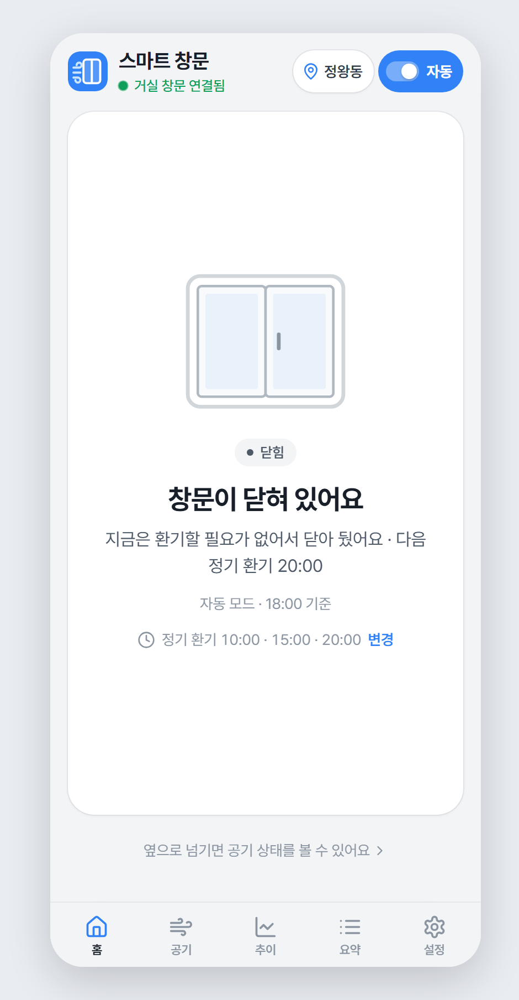
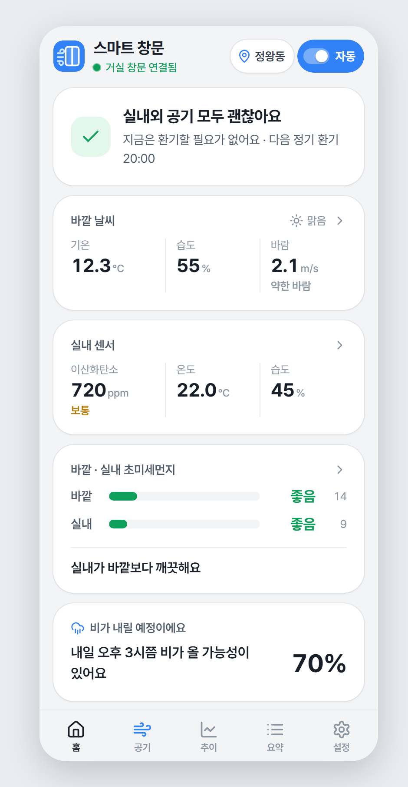
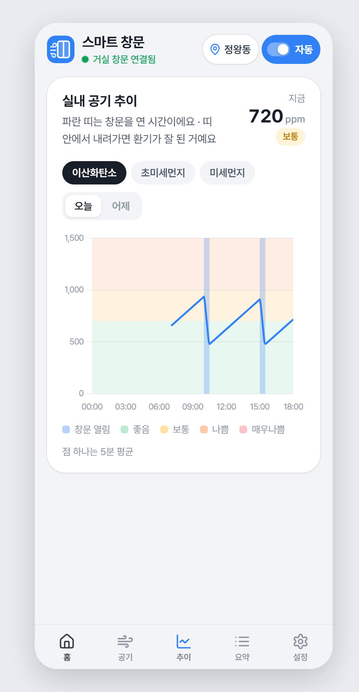
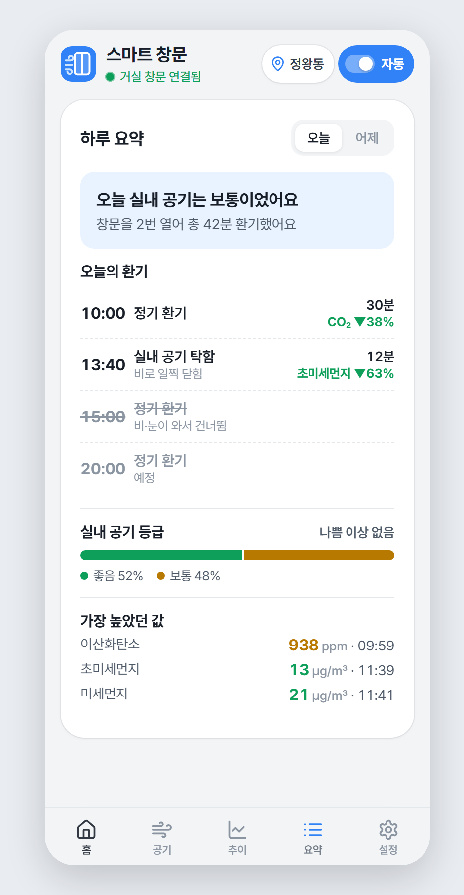
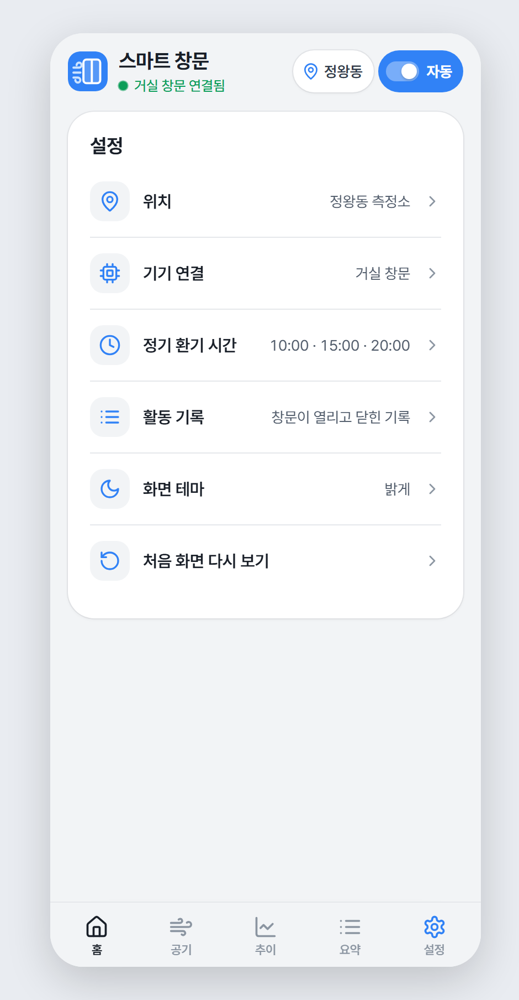
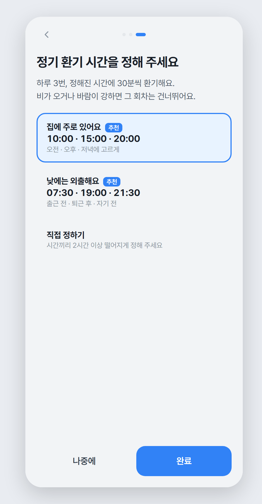

<div align="center">

# 스마트 창문 (SmartWindow)

**실내외 공기질을 비교해 창문을 자동으로 여닫는 IoT 환기 시스템**


캡스톤 디자인 · 김기평, 박현준, 오자빈

</div>

기상청·에어코리아 공공데이터로 바깥 날씨와 대기질을 수집하고, 라즈베리파이 센서로 실내 CO₂·미세먼지·온습도를 측정한다. 서버는 두 값을 비교해 **언제, 얼마 동안 창문을 열지** 판단하고, 라즈베리파이는 그 명령에 따라 서보모터로 창문을 움직인다. 사용자는 웹 대시보드에서 상태를 확인하고 원격으로 제어할 수 있다.

> **핵심 아이디어** — 바깥이 실내보다 깨끗할 때만, 필요한 만큼만 연다.
> 비·강풍·미세먼지는 항상 우선해서 막고, 하루 3번 정기 환기로 센서가 재지 못하는 오염물질까지 챙긴다.

---

## 목차

1. [화면](#화면)
2. [주요 기능](#주요-기능)
3. [기술 스택](#기술-스택)
4. [시스템 구성](#시스템-구성)
5. [창문 판단 로직](#창문-판단-로직)
6. [문제 해결 과정](#문제-해결-과정)
7. [실행 방법](#실행-방법)
8. [API](#api)
9. [외부 API](#외부-api)

---

## 화면

모바일 화면 기준 (샘플 데이터). 하단 탭바와 좌우 스와이프로 이동하며, PC에서는 한 화면에 펼쳐서 보여 준다.

<table>
  <tr>
    <td align="center" width="33%"><br /><b>홈</b><br /><sub>창문 상태와 쉬운 말로 된 판단 이유</sub></td>
    <td align="center" width="33%"><br /><b>공기</b><br /><sub>한 줄 결론 → 날씨 · 실내 센서 · 미세먼지 비교</sub></td>
    <td align="center" width="33%"><br /><b>추이</b><br /><sub>파란 띠 = 창문을 연 시간, 환기 효과가 바로 보임</sub></td>
  </tr>
  <tr>
    <td align="center"><br /><b>요약</b><br /><sub>하루 결산: 환기 기록 · 효과 · 건너뛴 회차</sub></td>
    <td align="center"><br /><b>설정</b><br /><sub>위치 · 기기 연결 · 정기 환기 · 테마</sub></td>
    <td align="center"><br /><b>처음 설정 · 정기 환기</b><br /><sub>추천안 2종 또는 직접 입력</sub></td>
  </tr>
</table>

| 화면 | 내용 |
|---|---|
| 처음 설정 | 시작하기 → 위치(현재 위치·지도) → 기기 선택(없으면 건너뛰기) → 정기 환기 시간. 완료 여부는 서버에 저장되어 한 번만 표시 |
| 홈 | 창문 열림/닫힘, 쉬운 말로 된 판단 이유, 다음 정기 환기 시각. 판단 근거는 눌렀을 때만 표시 |
| 공기 | 한 줄 결론 → 바깥 날씨(기온·습도·바람) → 실내 센서(CO₂·온도·습도) → 바깥·실내 초미세먼지 비교 → 비 소식 |
| 추이 | 오늘(0시~현재) / 어제. 이산화탄소·초미세먼지·미세먼지, 미세먼지는 바깥 값을 점선으로 함께 표시, 창문이 열려 있던 시간을 띠로 표시 |
| 요약 | 오늘 / 어제 하루 결산. 한 줄 결론, 회차별 환기 기록(이유·시간·효과), 비·강풍으로 건너뛴 회차와 남은 정기 환기, 실내 공기 등급 비율, 가장 높았던 값 |
| 설정 | 위치, 기기 연결, 정기 환기 시간, 활동 기록, 화면 테마, 처음 화면 다시 보기 |

---

## 주요 기능

| 기능 | 설명 |
|---|---|
| 자동 환기 | 안전 → 정기 환기 → 센서의 3단계 규칙으로 창문 개폐 판단 |
| 안전 차단 | 비·눈, 강풍(5 m/s 이상), 바깥 미세먼지 매우나쁨 시 즉시 닫힘 |
| 정기 환기 | 하루 3회 30분 환기, 시각은 사용자가 선택 (추천안 2종 또는 직접 입력) |
| 센서 기반 환기 | 실내 CO₂ 1,000ppm 이상 또는 실내 미세먼지가 바깥보다 높을 때 환기 |
| 수동 제어 | 열기·닫기, 타이머(N분 뒤 자동 닫힘)·연장·취소 |
| 처음 설정 | 첫 접속 시 위치 → 기기 연결 → 정기 환기 시간 순서로 안내 |
| 위치 변경 | 현재 위치 또는 지도에서 선택 시 가장 가까운 측정소로 전환하고 즉시 재조회 |
| 기기 연결 | 최근 데이터를 보낸 라즈베리파이를 목록으로 보여 주고 선택 |
| 기록 | 실내 센서(1분), 바깥 값(10분), 창문 활동 기록을 MySQL에 저장 |

---

## 기술 스택

| 구분 | 사용 기술 |
|---|---|
| Backend | Python, FastAPI, Uvicorn, SQLAlchemy |
| Database | MySQL (PyMySQL) |
| Frontend | HTML, CSS, JavaScript, Chart.js |
| Hardware | Raspberry Pi, SCD30(CO₂), PMS7003(미세먼지), 서보모터 ×2, pigpio |
| 외부 API | 기상청 단기예보 조회서비스, 에어코리아 대기오염정보·측정소정보, 네이버 지도 |

---

## 시스템 구성

```
[기상청 API]  ──┐
[에어코리아]  ──┤→ [FastAPI 서버] ←→ [웹 대시보드]
                │         ↕            (PC · 모바일)
                │    [MySQL 기록]
                │         ↕
[라즈베리파이] ←┘  실내 센서값 전송 / 창문 명령 수신
 (SCD30 · PMS7003 · 서보모터 · LED)
```

- 서버는 10분마다 바깥 값을 갱신하고, 1초마다 환기 종료·정기 시각·실내 공기 변화를 확인한다.
- 라즈베리파이는 `/api/sensors`로 실내 값을 보내고 `/api/command`로 창문 상태(`open` / `closed`)를 받아 서보모터를 구동한다.

| 파일 | 역할 |
|---|---|
| `app.py` | 판단 로직, 상태 관리, REST API, 백그라운드 워커 |
| `external.py` | 기상청·에어코리아 API 호출, 위경도 → 기상청 격자 변환 |
| `db.py` | ORM 모델(실내·바깥 기록, 활동 기록, 설정), 조회·보존 기간 관리 |
| `config.py` | `.env` 기반 설정 로드 |
| `templates/dashboard.html` | 대시보드 화면 |
| `static/style.css` | 반응형 스타일 |

---

## 창문 판단 로직

평소에는 닫아 두고, 환기가 필요할 때만 정해진 시간 동안 연다. 위에서부터 순서대로 확인한다.

### ① 안전 (항상 우선, 환기 중에도 중단)

| 조건 | 결과 |
|---|---|
| 날씨·대기질 수신 실패 | 닫힘 (안전 모드) |
| 비·눈 (기상청 실황 또는 가장 가까운 예보) | 닫힘 |
| 풍속 5.0 m/s 이상 (현재 값과 1시간 내 예보 중 최댓값) | 닫힘, 4.0 m/s 미만에서 재개방 |

### ② 정기 환기

- 하루 3회 환기 (환경부 하루 3회 환기 권고 기준). 시각은 사용자가 정함
  - 추천안: 집에 주로 있음 10:00 · 15:00 · 20:00 (기본값) / 낮에 외출 07:30 · 19:00 · 21:30
  - 직접 입력 시 회차 간격 2시간 이상 (자정을 넘는 간격 포함)
- 센서로 측정하지 않는 오염물질(폼알데하이드, VOC 등)을 고려한 고정 환기
- 안전 조건으로 열지 못하면 30분간 재시도 후 해당 회차 생략
- 정기 시각 1시간 이내에 이미 환기했다면 해당 회차 생략

### ③ 센서

- 실내 CO₂ 1,000ppm 이상 (실내공기질 관리법 유지기준)
- 실내 미세먼지가 바깥보다 5 μg/m³ 이상 높음 (실내 PM2.5 15, PM10 30 이상일 때)

### 바깥 대기질별 환기 시간 (환경부 예보 등급 기준)

| 바깥 공기 | 기준 (μg/m³) | 환기 |
|---|---|---|
| 좋음·보통 | PM10 ≤ 80, PM2.5 ≤ 35 | 30분 |
| 나쁨 | PM10 > 80 또는 PM2.5 > 35 | 10분 |
| 매우나쁨 | PM10 > 150 또는 PM2.5 > 75 | 닫음 (CO₂ 2,000ppm 이상일 때만 10분) |

### 환기 종료

- 환기 시간 경과
- 바깥 공기 악화 (매우나쁨 즉시, 나쁨 10분 후)
- 10분 이상 환기 후 CO₂ 700ppm 미만 → 조기 종료
- 종료 후 30분간 재개방하지 않음

---

## 문제 해결 과정

**1. 창문이 열리고 닫히기를 반복하는 문제**
기준값 하나로 열고 닫으면 경계 근처에서 개폐가 반복되었다. 여는 기준과 닫는 기준을 분리하고(CO₂ 1,000 / 700ppm, 풍속 5.0 / 4.0 m/s), 환기 후 30분 휴지 시간을 두어 해결했다.

**2. 화면의 풍속이 체감과 다른 문제**
안전 판단을 위해 1시간 예보 중 최댓값을 쓰다 보니, 화면에도 실제보다 강한 바람이 표시되었다. 표시용 값(가장 가까운 시각 예보)과 판단용 값(관측값과 1시간 내 예보의 최댓값)을 분리했다.

**3. 기상청 실황의 갱신 지연**
초단기실황은 1시간 단위로 발표되어 비가 막 시작된 상황을 늦게 반영했다. 초단기실황과 초단기예보를 병렬로 조회해, 둘 중 하나라도 강수이면 닫도록 했다.

**4. 자정 무렵 예보 시각 선택 오류**
예보를 시각(`HHMM`)만으로 정렬해 자정을 넘는 구간에서 엉뚱한 시각의 예보를 선택했다. 날짜와 시각을 함께 비교하도록 수정했다.

**5. 위치 변경 후 이전 위치 값이 덮어쓰는 문제**
위치를 바꾼 직후 이전 위치의 조회 결과가 늦게 도착하면 새 위치 값을 덮어썼다. 위치마다 토큰을 발급해 현재 위치와 다른 응답은 버리고, 위치 변경 즉시 백그라운드에서 재조회하도록 했다.

**6. 센서가 꺼졌을 때의 오판단**
라즈베리파이가 꺼져도 마지막 실내 값으로 계속 판단했다. 수신 후 5분이 지난 실내 값은 판단에서 제외하도록 했다.

**7. 파일 기반 기록의 한계**
JSON 파일 기록은 개수 제한과 동시 접근 문제가 있었다. MySQL(SQLAlchemy)로 전환하고, 기존 JSON 기록은 서버 시작 시 자동으로 이관되도록 했다.

**8. 정보가 많아 이해하기 어렵다는 피드백**
공기 화면이 숫자와 단위 위주여서, 사용자가 값을 직접 해석하고 바깥과 실내를 머릿속으로 비교해야 했다. 화면을 **결론 → 비교 → 근거** 순서로 바꾸고, 등급(좋음·보통)을 크게·숫자를 작게 표시했으며, 단위와 출처는 자세히 보기로 옮겼다. 지금 비가 오는데 "비가 내릴 예정"이 함께 보이던 표시 충돌도 정리했다.

**9. 로그인 없이 설정을 기기 간에 유지**
로그인 기능이 없어 브라우저에 설정을 저장하면 폰과 PC의 설정이 달라졌다. 창문 하나에 설정 하나라는 전제로 위치·기기·정기 환기 시간·처음 설정 완료 여부를 서버 DB에 저장해, 어떤 기기로 접속해도 같은 설정을 쓰도록 했다.


**10. 탭마다 역할이 겹치고 기간 기준이 제각각인 문제**
추이 차트는 1·6·24시간, 요약은 최근 1시간이라 기준이 서로 달랐고, 1시간 차트와 1시간 요약은 같은 내용을 반복했다. 탭의 역할을 **공기 = 지금 상태, 추이 = 시간에 따른 변화, 요약 = 하루 결산**으로 나누고, 의미가 분명하지 않은 기간 대신 사람이 생각하는 단위인 **오늘 / 어제**로 통일했다. 추이 차트에는 창문이 열려 있던 시간을 띠로 표시하고, 요약에는 회차별 환기 이유와 전후 효과를 보여 주어 "창문이 무엇을 했고 효과가 있었는지"가 드러나도록 했다.

---

## 실행 방법

**1. 패키지 설치**

```bash
pip install fastapi uvicorn pydantic requests sqlalchemy pymysql cryptography
```

**2. 데이터베이스 생성** (테이블은 서버 시작 시 자동 생성)

```sql
CREATE DATABASE smartwindow CHARACTER SET utf8mb4 COLLATE utf8mb4_unicode_ci;
```

**3. 환경 변수 (`.env`)**

```bash
AIR_KOREA_KEY=<공공데이터포털 인증키>
KMA_KEY=<공공데이터포털 인증키>

DB_HOST=localhost
DB_PORT=3306
DB_NAME=smartwindow
DB_USER=<MySQL 사용자>
DB_PASSWORD=<MySQL 비밀번호>

# 선택 항목 (기본값)
FIXED_LAT=37.3392
FIXED_LON=126.7366
AUTO_INTERVAL_SECONDS=600
PORT=5000

# 시연용 환기 주기 테스트
# VENT_CYCLE_TEST=1
# VENT_CYCLE_OPEN_SECONDS=60
# VENT_CYCLE_CLOSE_SECONDS=30
```

**4. 실행**

```bash
python app.py
```

대시보드 `http://localhost:5000` · API 문서 `http://localhost:5000/docs`

---

## API

| 메서드 | 경로 | 설명 |
|---|---|---|
| `GET` | `/` | 웹 대시보드 |
| `GET` | `/api/status` | 전체 상태 조회 |
| `GET` | `/api/command` | 라즈베리파이 창문·LED 명령 (`?device=` 기기 이름) |
| `POST` | `/api/sensors` | 실내 센서값 수신 |
| `POST` | `/api/mode` | 모드 전환 (`auto` / `manual`) |
| `POST` | `/api/window` | 수동 창문 제어 (`open` / `closed`) |
| `POST` | `/api/window/timer` | 타이머 개방 |
| `POST` | `/api/window/timer/cancel` | 타이머 취소 |
| `POST` | `/api/window/timer/extend` | 타이머 연장 |
| `POST` | `/api/location` | 위치 변경 (`lat`, `lng`) |
| `POST` | `/api/schedule` | 정기 환기 시각 저장 (`times`: `HH:MM` 3개) |
| `GET` | `/api/devices` | 최근 1분 안에 데이터를 보낸 기기 목록 |
| `POST` | `/api/device` | 연결할 기기 선택 (`name`, 없으면 연결 해제) |
| `POST` | `/api/onboarding` | 처음 설정 완료 저장 |
| `GET` | `/api/indoor-history` | 실내 기록 (`?day=today/yesterday` 또는 `?hours=1`) |
| `GET` | `/api/air-history` | 바깥 기록 (`?day=today/yesterday` 또는 `?hours=1`) |
| `GET` | `/api/window-spans` | 그날 창문이 열려 있던 구간 (`?day=today/yesterday`) |
| `GET` | `/api/day-summary` | 그날 환기 기록(이유·시간·전후 효과), 건너뛴·남은 정기 환기 (`?day=today/yesterday`) |
| `GET` | `/api/vent-effect` | 마지막 환기 전후 실내 공기 비교 |
| `GET` | `/api/events` | 활동 기록 (`?limit=30`) |

**요청·응답 예시**

```bash
# 실내 센서값 전송
POST /api/sensors
{"device": "거실 창문", "pm25": 12.3, "pm10": 25.0, "co2": 800, "temperature": 24.5, "humidity": 55}
# device 를 생략하면 '라즈베리파이'로 표시

# 창문 명령 조회
GET /api/command
{"led": "on", "window": "open", "mode": "auto", "reason": "CO₂ 높음(1050ppm) → 30분 환기"}
```

---

## 외부 API

| API | 용도 |
|---|---|
| 기상청 초단기실황 | 현재 기온·습도·풍속·풍향·강수 |
| 기상청 초단기예보 | 1시간 내 바람·강수 (판단), 화면 표시용 날씨 |
| 기상청 단기예보 | 48시간 비 소식 (강수확률) |
| 에어코리아 측정소정보 | 좌표 기준 가장 가까운 측정소 조회 |
| 에어코리아 대기오염정보 | 측정소 실시간 PM10·PM2.5 |
| 네이버 지도 | 처음 설정·설정 화면의 위치 선택 |
